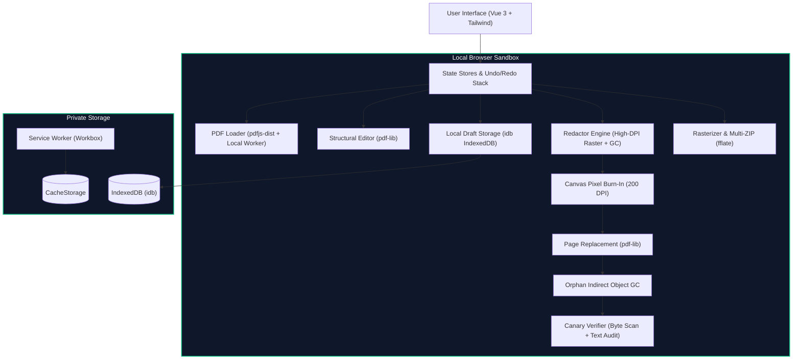

# PrintSign PDF Editor — 100% Client-Side PDF Editor

A high-performance, private, zero-backend PDF editor and redaction application running **entirely in the client browser**. No remote servers, no serverless functions, no CDN runtime requests, no telemetry, and zero data leaves the user's machine.

---

## Architecture Overview



---

## Key Features & Capabilities

| Module | Features Supported |
| :--- | :--- |
| **Document Viewing** | Multi-file tabs, drag-and-drop, zoom in/out/100%, Fit Width, Fit Page, continuous scroll, single-page view, keyboard shortcuts. |
| **Thumbnails & Page Ops** | Thumbnail sidebar, drag-to-reorder, 90° clockwise/counter-clockwise rotation, insert blank page, duplicate page, delete single/multi-page, crop editor, extract pages to new PDF, merge additional PDFs, split by page ranges. |
| **True Redaction** | Dedicated Redaction Workspace, click-and-drag box drawing, Search-and-Redact batch tool, solid black and "REDACTED" presets, High-DPI canvas burn-in, replacement page embedding, unreferenced stream unlinking, **Orphan Object Garbage Collection**, and automated verification report modal. |
| **Verification Suite** | Test 3a (Text extraction check), Test 3b (Raw binary byte scan), and Test 3c (Negative control proving detection of fake redactions). |
| **Metadata & XMP** | Read and edit standard Info dictionary (Title, Author, Subject, Keywords, Creator, Producer, Creation/Mod Dates), raw XMP XML packet editor/viewer, document statistics, and **One-Click Metadata Scrubbing**. |
| **Rasterization** | 72, 150, 300, 600 DPI, PNG, JPEG (quality slider), WebP, live dimension preview calculator, client-side ZIP archive export (`fflate`), and **Flatten to Image-Only PDF**. |
| **Offline PWA** | Installable Progressive Web App (`vite-plugin-pwa`), Workbox service worker precaching all scripts, styles, worker, fonts, and cmaps for 100% offline usage. |
| **UX & Safety** | 25-step Undo/Redo stack (Ctrl+Z / Ctrl+Shift+Z), IndexedDB autosave drafts & crash recovery, persistent privacy banner, password prompt for encrypted inputs, signature invalidation alerts, and destructive confirmation modals. |

---

## Setup, Build, and Run Instructions

### Prerequisites
- Node.js >= 18 (Tested on Node.js v24)
- npm >= 9

### Installation
```bash
# Clone or navigate to repository
cd "pdf software"

# Install dependencies
npm install
```

### Development Server
```bash
npm run dev
```
Open [http://localhost:5173](http://localhost:5173) in your browser.

### Production Build & Preview
```bash
# Type check and build bundle
npm run build

# Preview production build locally
npm run preview
```

### Running Test Suite
```bash
# Run unit tests (canary verification, GC, page ops, metadata)
npm run test

# Run Playwright E2E tests (zero-network audit, offline mode, redaction flow)
npm run test:e2e
```

---

## Redaction Architecture: Why Client-Side Matters

Conventional online tools require uploading your confidential PDFs (medical records, legal discovery, tax files) to a cloud server to apply redactions. This presents catastrophic exfiltration risks.

Furthermore, naive desktop tools often simply draw a black rectangle over text without removing the underlying character coordinates, leaving confidential text extractable.

PrintSign PDF Editor solves both:
1. **Zero Network:** The file never leaves your computer.
2. **Rasterize-Burn-and-Rebuild + GC:** The page is rendered as pixels, blacked out, replaced as a pure image, and all unreferenced text streams are deleted via our indirect object garbage collector.

---

## Keyboard Shortcuts

- `Ctrl + Z` / `Cmd + Z`: Undo last action
- `Ctrl + Shift + Z` / `Ctrl + Y`: Redo
- `Ctrl + S`: Save / Export PDF
- `Ctrl + =` / `Ctrl + +`: Zoom In
- `Ctrl + -`: Zoom Out
- `Ctrl + 0`: Reset Zoom (100%)
- `R`: Rotate selected page(s) 90° clockwise
- `Shift + R`: Rotate selected page(s) 90° counter-clockwise
- `Delete` / `Backspace`: Delete selected page(s)

---

## Known Limitations & Out of Scope

- **Vector-Preserving Redaction (V2 Roadmap):** V1 intentionally rasterizes redacted pages to guarantee zero text leakage without native vector editing bugs. Vector-preserving redaction via `mupdf.js` (WASM) is planned for V2.
- **Encrypted PDF Export:** Dropped from V1 to prevent false security from imperfect third-party encryption shims. Decryption of password-protected input PDFs is fully supported.
- **Digital Signatures:** Any edit to a signed PDF invalidates cryptographic signatures. The app detects signed files and displays a prominent warning.
- **Out of Scope:** Cloud accounts, file sharing, remote sync, and creating new PDFs from scratch (beyond blank pages).
