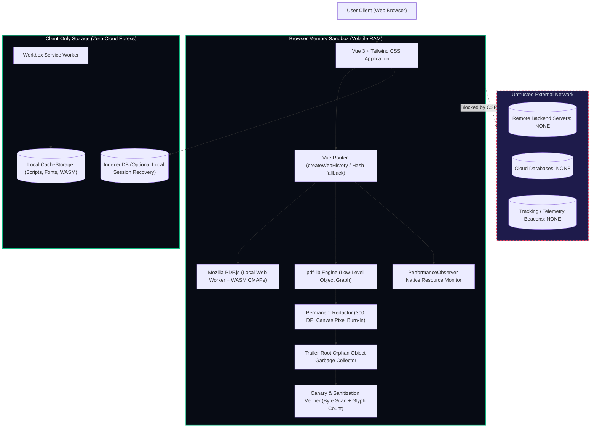

# PrintSign — 100% Client-Side, Zero-Cloud PDF Sanitization & Redaction Engine

[](https://printsign.org/f12-network-audit)
[](https://printsign.org/security-architecture)
[](https://printsign.org/blog/offline-pwa-pdf-editor-how-it-works)
[-38bdf8?style=for-the-badge&logo=vitest)](https://printsign.org/)
[](LICENSE)

> **PrintSign** is a free, open-source, zero-backend document utility designed for legal counsel, healthcare providers (HIPAA), investigative journalists (FOIA), and privacy-conscious enterprises. Every operation — from 300 DPI permanent pixel redaction to XMP metadata stripping and PDF concatenation — executes **100% in local browser memory (RAM)** with zero remote API calls, zero server uploads, and zero tracking telemetry.

---

## Live Production Tools

All tools are pre-rendered into static HTML with full offline Progressive Web App (PWA) precaching:

| Tool | Production URL | Primary Use Case & Security Assurance |
| :--- | :--- | :--- |
| **PDF Redaction & Metadata Verifier** | [`/verify-redaction`](https://printsign.org/verify-redaction) | Audits PDFs for cosmetic black boxes, active selectable text layers, and leaked XMP metadata packets in RAM. |
| **F12 Zero-Network & RAM Audit** | [`/f12-network-audit`](https://printsign.org/f12-network-audit) | Live `PerformanceObserver` network monitor & in-memory benchmark verifying zero outbound API requests (`fetch`/`xhr` = 0). |
| **Permanent 300 DPI Redactor** | [`/redact-pdf`](https://printsign.org/redact-pdf) | Physically burns redaction shapes into canvas pixels; expunges underlying vector text streams to prevent copy-paste leaks. |
| **Metadata & XMP Scrubber** | [`/scrub-pdf-metadata`](https://printsign.org/scrub-pdf-metadata) | Purges `/Author`, `/Creator`, `/Producer`, GPS telemetry, and catalog XML metadata packets. |
| **In-Browser PDF Merge** | [`/merge-pdf`](https://printsign.org/merge-pdf) | Concatenates multiple PDF files in local memory with XRef table rebuilding and zero cloud transmission. |
| **Client-Side PDF Splitter** | [`/split-pdf`](https://printsign.org/split-pdf) | Extracts custom page ranges and bursts documents into individual files entirely in browser RAM. |
| **High-DPI Rasterizer** | [`/flatten-rasterize-pdf`](https://printsign.org/flatten-rasterize-pdf) | Converts vector PDFs and AcroForm fields into flattened 300/600 DPI pure-image defensible files. |
| **Page Organizer & Rotator** | [`/reorder-rotate-pdf`](https://printsign.org/reorder-rotate-pdf) | Drag-and-drop page reordering, 90° clockwise/counter-clockwise rotation, and single-page deletion. |
| **Lossless PDF Compressor** | [`/compress-pdf`](https://printsign.org/compress-pdf) | Strips duplicate font tables, unreferenced orphan objects, and re-compresses Flate/Deflate streams. |
| **HIPAA Compliance Redactor** | [`/hipaa-compliant-pdf-redaction`](https://printsign.org/hipaa-compliant-pdf-redaction) | Complies with 45 CFR § 164.514(b)(2) Safe Harbor de-identification for medical charts and patient EHRs. |
| **NIST SP 800-88 Sanitizer** | [`/nist-800-88-pdf-sanitization`](https://printsign.org/nist-800-88-pdf-sanitization) | Defensible document sanitization adhering to NIST SP 800-88 R1 media sanitization standards. |
| **Private Cloud Alternative** | [`/ilovepdf-smallpdf-offline-alternative`](https://printsign.org/ilovepdf-smallpdf-offline-alternative) | High-performance, zero-upload alternative to commercial SaaS converters (Smallpdf, iLovePDF, Adobe). |

---

## Architecture Overview



---

## Why Client-Side Redaction Matters: The "Black Box" Vulnerability

Over 90% of public data leaks in legal discovery (FRCP Rule 5.2) and government FOIA disclosures occur because users draw cosmetic black vector shapes over sensitive text in Adobe Acrobat or Apple Preview.

### The Forensic Problem
In the PDF ISO 32000 specification:
1. Drawing a black box simply appends a vector path operator (`re` / `f`) to the page content stream.
2. The underlying character glyph indices, font matrices, and OCR text coordinates remain **100% intact**.
3. Anyone can press `Ctrl + A`, copy the text, or extract it via `pdftotext`.
4. Even if content streams are altered, deleted objects often persist as **orphans** in uncompressed incremental revision trailers.

### PrintSign's Defense-in-Depth Solution
```
[Original PDF Buffer] 
        │
        ▼
[300 DPI Hardware-Accelerated Canvas Rendering] 
        │ (Physical pixel burn-in of redaction geometry)
        ▼
[Replacement of Target Page as Pure Bitmap Object]
        │ (All underlying vector text operators expunged)
        ▼
[Trailer-Root Graph Traversal & Orphan GC]
        │ (Walks catalog tree; deletes unreferenced indirect objects)
        ▼
[Byte-Level Canary & Extraction Audit]
        │ (Verifies zero secret string presence in final ArrayBuffer)
        ▼
[Sanitized PDF Downloaded Directly from RAM]
```

---

## Independent Security & Network Verification (F12 Protocol)

We encourage every security auditor, Data Protection Officer (DPO), and directory reviewer to verify our zero-cloud claims in **10 seconds**:

1. Open PrintSign in any browser ([https://printsign.org/f12-network-audit](https://printsign.org/f12-network-audit)).
2. Press `F12` (or right-click → **Inspect**) and navigate to the **Network** tab.
3. Filter by **Fetch / XHR**.
4. Drag a confidential 100-page PDF, perform redacting, merging, or metadata scrubbing, and click export.
5. **Observed Result:** The Fetch/XHR log remains completely empty (`0 requests, 0 bytes transmitted`).
6. **Air-Gap Verification:** Set network throttling to **Offline** (or disconnect your physical Wi-Fi/Ethernet) and reload. PrintSign runs with zero degradation via pre-cached Service Worker assets.

---

## Local Development & Testing

### Prerequisites
- Node.js >= 18.0.0 (Tested on Node.js v20 & v24 LTS)
- npm >= 9.0.0

### Setup
```bash
# Clone the repository
git clone https://github.com/Ansari-Codes/printsign.git
cd printsign

# Install dependencies cleanly
npm ci
```

### Development Server
```bash
npm run dev
```
Open [http://localhost:5173](http://localhost:5173) in your browser.

### Test Suite Execution
```bash
# Run full Vitest suite (Canary redaction tests, GC, metadata, verifier, SEO routes)
npm test

# Run unit tests with UI watcher
npx vitest --ui
```

### Production Build & Pre-Rendering
```bash
# Type-check TypeScript, build Vite client bundle, and pre-render 43 static SEO heads
npm run build

# Preview production build locally
npm run preview
```

---

## Technical Specifications & Standards Compliance

- **Document Engine:** Mozilla PDF.js v5 (WASM/Worker) + `pdf-lib` v1.17
- **Compression:** High-throughput streaming DEFLATE via `fflate`
- **PWA Framework:** Workbox Service Worker with offline asset precaching
- **Regulatory Defensibility:**
  - **HIPAA:** 45 CFR § 164.514(b)(2) (Safe Harbor de-identification)
  - **GDPR:** Article 28 (Eliminates Third-Party Data Processor liabilities)
  - **NIST:** SP 800-88 Rev. 1 (Media Sanitization Guidelines)
  - **Federal Court Rules:** FRCP Rule 5.2 & Criminal Rule 49.1 compliance

---

## License

This project is licensed under the **MIT License** — see the [LICENSE](LICENSE) file for details.
